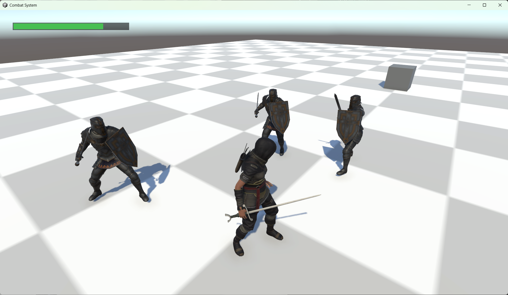

# Combat System

一个第三人称动作战斗原型。

目标不是"做很多敌人"，而是让**多敌人围攻**变得**有节奏、看得清、打得爽**——灵感来自《蝙蝠侠：阿卡姆》系列和《刺客信条》的群战设计。



> 三个守卫把你围住，但同一时刻只有一个会真正出手。

---

## 为什么要做这个

大多数"割草"式群战的问题是：**敌人各打各的**。四个敌人同时冲上来，玩家被围在中间，看不清谁在出手，只能乱按或者被活活磨死——混乱且憋屈。

阿卡姆和刺客信条的做法是：**表面上被围攻，实际上同一时刻只有一个敌人真正出手**。玩家永远有一个可以反应的威胁，其余敌人则用"包围感"制造压力。

这个原型把这条思路拆成了四个可以独立验证的机制。

---

## 四个核心机制

### 1. 攻击令牌（Attack Token）

`CombatDirector` 是这场战斗的"导演"，手里只有一张令牌。

- **同一时刻只有一个人能进攻**，其余敌人只能待机、环绕、等待
- 出手顺序按"等得最久"轮转，保证公平
- 全局攻击间隔（默认 1.6 秒）控制整场战斗的节奏——这是**唯一的节奏旋钮**
- 玩家打中某个敌人时，它可以**插队抢令牌**反击，但有 2.5 秒冷却
- 持牌者如果被连续压制 1.5 秒，会**主动放弃令牌**，把机会让给别人

> 效果：玩家不会一打多被围殴，但也无法靠"按住一个敌人"锁死整场战斗。

### 2. 编队槽位（Combat Formation）

`CombatFormation` 把玩家周围分成 6 个角度槽位（0°、60°、120°…），参战敌人各自占一个。

- **就近分配**：进入战斗时挑一个角度差最小的空槽，不会横穿战场
- **槽位满员**：共用角度 + 半径递增（3.0 / 4.2 / 5.4 米），视觉上前后错开
- 敌人偏离槽位超过 25° 会主动走回去，**走位时始终面向玩家**（用侧移动画）
- 环绕被限制在槽位附近 ±30° 的小扇形内，不会满场乱跑

> 效果：玩家被均匀地"围住"，而不是被挤在墙角。

### 3. 弹反（Parry）

按 `E` 开启 0.25 秒判定窗口，窗口内敌人从正面攻击即弹反成功。

- **最高优先级**：能打断玩家自己的攻击（未结算的伤害作废）、锁定移动与攻击输入
- 成功后：**顿帧 0.06 秒 + 相机震动 + 敌人进入 1.2 秒硬直**
- 弹反期间敌人**继续持有令牌**——其他敌人不能趁虚而入，玩家有完整的输出窗口
- 弹反硬直**不计入**"被压制时长"，保证弹反的收益不被机制吃掉

> 效果：高风险高回报，弹反成功就是一个明确的进攻信号。

### 4. 数据驱动

- `AttackDefinitionSO`：一段攻击的动画状态、判定窗口（归一化 0~1）、伤害、冷却
- `CharacterDataSO`：角色血量等基础数据，三个敌人共享同一个资产

> 效果：加招式 / 调数值不需要改代码。

---

## 操作

| 按键 | 功能 |
|---|---|
| `W A S D` | 移动（相对相机方向） |
| `Shift` | 冲刺 |
| `Space` | 跳跃 |
| `鼠标左键` | 攻击（两段连招，60% 概率接第二段） |
| `E` | 弹反 |
| `鼠标` | 转动视角（第三人称环绕相机） |

---

## 战斗循环

```
敌人发现玩家
   ↓
追击 → 进入 3 米战斗距离 → 占一个编队槽位
   ↓
包围玩家（站桩 / 环绕等待）
   ↓
拿到令牌 → 走向玩家 → 攻击 1~2 段 → 后撤 → 归还令牌
   ↓                                        ↑
玩家弹反/打中它 → 打断攻击 ────────────────┘
```

---

## 系统一览

| 模块 | 说明 |
|---|---|
| 第三人称相机 | 角度驱动（yaw/pitch），带防穿墙 SphereCast |
| 角色移动 | CharacterController + 相机相对方向 + 加减速 |
| 敌人状态机 | 站岗 / 追击 / 战斗待机 / 环绕 / 攻击 / 后撤 / 死亡 |
| 命中判定 | 武器碰撞盒 或 角色前方区域，窗口内逐帧 OverlapBox |
| 伤害与死亡 | `CharacterStats` + 死亡动画 + 碰撞关闭 |
| 反馈 | 受击动画、相机抖动（trauma 模型）、顿帧（timeScale） |
| UI | 玩家血条（绿条 + 延迟红条） |
| 编队 | 6 槽位角度分配 + 半径错开 |

---

## 运行

### 直接玩

从 [Releases](../../releases) 下载最新的 Windows 压缩包，解压后运行 `Combat System.exe`。

默认窗口 1920×1080，可缩放；`Alt + Enter` 可切换全屏。

### 从源码打开

1. Unity **2022.3.62f3c1**（URP 14.0.12）
2. 打开项目，加载 `Assets/Scenes/Test.unity`
3. Play

---

## 目录结构

```
Assets/
├── Scripts/
│   ├── Combat/          战斗核心
│   │   ├── CombatDirector.cs      攻击令牌
│   │   ├── CombatFormation.cs     编队槽位
│   │   ├── AttackController.cs    攻击流程（接近/出手/后撤）
│   │   ├── AttackDefinitionSO.cs  招式数据
│   │   ├── CharacterDataSO.cs     角色数据
│   │   ├── CharacterStats.cs      血量
│   │   ├── MeleeHitbox.cs         命中判定
│   │   ├── PlayerParry.cs         弹反
│   │   ├── PlayerHitReaction.cs   玩家受击
│   │   ├── EnemyHitReaction.cs    敌人受击
│   │   └── PlayerDeath.cs         玩家死亡
│   ├── Enemy/           敌人状态机
│   │   ├── EnemyController.cs
│   │   └── States/      Guard/Chase/CombatIdle/Orbit/Attack/Retreat/Dead
│   ├── PlayerControl/   相机与移动
│   ├── Core/            GameManager / HitStop / CameraShake
│   └── UI/              血条
├── Animations/          Animator Controller 与动画
├── Combat/Attacks/      招式数据资产
├── Combat/Characters/   角色数据资产
└── Scenes/Test.unity    演示场景
```

---

## 已完成 / 待做

**已完成**

- [x] 第三人称移动 + 环绕相机
- [x] 数据驱动的攻击与连招
- [x] 弹反（判定窗口 + 优先级 + 顿帧 + 震动）
- [x] 血量、受击、死亡
- [x] 玩家血条 UI
- [x] 攻击令牌（轮转、抢牌、压制放弃）
- [x] 多敌人编队槽位
- [x] Windows 构建

**待做**

- [ ] 敌人攻击预警（起手定格），让弹反更好抓
- [ ] 伤害数字飘字
- [ ] Boss 血条
- [ ] 玩家死亡后的重开流程
- [ ] 受击闪白等打击表现
- [ ] 更多招式与敌人类型

---

## 素材

- 角色与动画来自 [Mixamo](https://www.mixamo.com/)（免费）
- 剑模型：antique_estoc_4k
- 其余为 Unity 内置资源

---

## 说明

这是一个**技术验证原型**，重点在战斗系统的结构与手感，不是完整游戏：

- 只有一个测试场景、一种敌人
- 没有关卡、存档、UI 菜单
- 数值（血量、冷却、窗口）都在资产或 Inspector 里，可直接调
